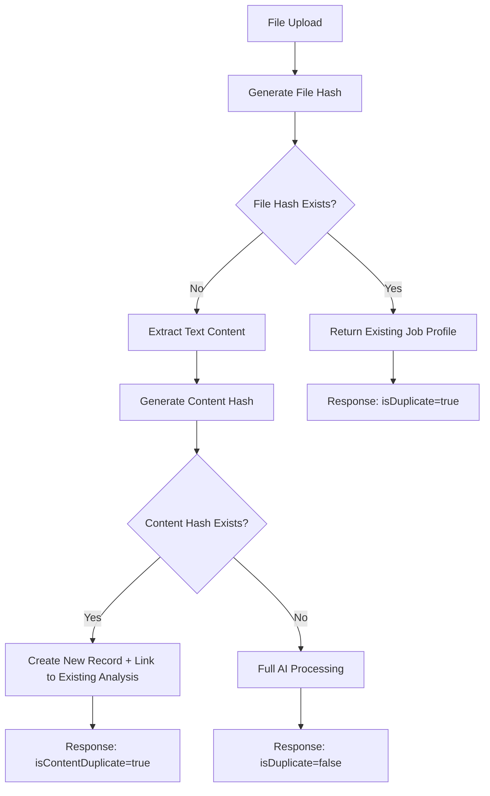

# JD Upload Deduplication System

## 🎯 Overview

The JD Upload System now includes comprehensive deduplication to prevent multiple copies of the same job description from being processed unnecessarily. This saves processing time, storage space, and provides a better user experience.

## 🔍 How Deduplication Works

### Two-Level Deduplication Strategy

#### 1. **File-Level Deduplication** (Exact File Match)
- **Hash**: SHA-256 hash of the original file binary content
- **Scope**: Per user (users can't see each other's duplicates)
- **Behavior**: If the exact same file is uploaded again, return the existing job profile immediately
- **Processing Time**: ~0ms (instant response)

#### 2. **Content-Level Deduplication** (Same Content, Different Files)
- **Hash**: SHA-256 hash of normalized extracted text content
- **Normalization**: Removes punctuation, normalizes whitespace, converts to lowercase
- **Scope**: Per user
- **Behavior**: If the same content is detected (even from a different file), link to existing analysis
- **Processing Time**: ~2-5 seconds (text extraction + content comparison)

## 📊 Deduplication Flow



## 🗄️ Database Schema Changes

### New Fields in `job_profiles` Table:
```sql
-- File deduplication
file_hash VARCHAR(128)          -- SHA-256 of original file
content_hash VARCHAR(128)       -- SHA-256 of normalized content
duplicate_of UUID               -- Reference to original if duplicate
```

### Enhanced `file_uploads` Table:
```sql
-- Content tracking
content_hash VARCHAR(128)       -- SHA-256 of extracted content
```

### Performance Indexes:
```sql
-- Deduplication lookup indexes
CREATE INDEX idx_job_profiles_created_by_file_hash ON job_profiles(created_by, file_hash);
CREATE INDEX idx_job_profiles_created_by_content_hash ON job_profiles(created_by, content_hash);
CREATE INDEX idx_file_uploads_uploaded_by_file_hash ON file_uploads(uploaded_by, file_hash);
```

## 🔧 Implementation Details

### File Hash Generation
```javascript
// Exact binary hash of uploaded file
const fileHash = crypto.createHash('sha256').update(file.buffer).digest('hex');
```

### Content Hash Generation
```javascript
// Normalized content hash for content deduplication
generateContentHash(text) {
  const normalizedText = text
    .toLowerCase()
    .replace(/\s+/g, ' ')      // Normalize whitespace
    .replace(/[^\w\s]/g, '')   // Remove punctuation
    .trim();
  
  return crypto.createHash('sha256').update(normalizedText).digest('hex');
}
```

### Deduplication Check Process
```javascript
// 1. Check for exact file duplicate
const duplicateCheck = await this.checkForDuplicateFile(fileHash, userId);
if (duplicateCheck.isDuplicate) {
  return existingJobProfile; // Instant response
}

// 2. Extract text and check content duplicate
const contentHash = this.generateContentHash(extractedText);
const contentDuplicateCheck = await this.checkForDuplicateContent(contentHash, userId);
if (contentDuplicateCheck.isDuplicate) {
  return linkToExistingAnalysis; // Skip AI processing
}

// 3. Process as new unique content
return fullAIProcessing;
```

## 📝 Response Types

### 1. Exact File Duplicate
```json
{
  "success": true,
  "isDuplicate": true,
  "jobProfileId": "existing-profile-id",
  "jobProfile": { /* existing profile data */ },
  "message": "This file has already been processed. Returning existing job profile: 'Backend Engineer – AWS & Java'",
  "originalUploadDate": "2025-06-15T20:30:00Z",
  "metrics": {
    "processingTime": 0,
    "duplicateDetection": true
  }
}
```

### 2. Content Duplicate (Different File)
```json
{
  "success": true,
  "isDuplicate": true,
  "isContentDuplicate": true,
  "jobProfileId": "new-record-id",
  "originalJobProfileId": "existing-analysis-id",
  "jobProfile": { /* existing analysis data */ },
  "message": "This job description content has already been processed. Created new record but linked to existing analysis: 'Backend Engineer – AWS & Java'",
  "originalProcessingDate": "2025-06-15T20:30:00Z",
  "metrics": {
    "textLength": 1434,
    "wordCount": 245,
    "processingTime": 3200,
    "contentDuplicateDetection": true
  }
}
```

### 3. Unique Content (New Processing)
```json
{
  "success": true,
  "isDuplicate": false,
  "jobProfileId": "new-profile-id",
  "jobProfile": { /* newly processed data */ },
  "metrics": {
    "textLength": 1434,
    "wordCount": 245,
    "aiConfidence": 87,
    "parametersGenerated": 3,
    "processingTime": 15400,
    "fileHash": "a1b2c3d4e5f6...",
    "contentHash": "f6e5d4c3b2a1..."
  }
}
```

## 🎯 Benefits

### Performance Benefits
- **Instant Response**: File duplicates return in ~0ms
- **Reduced AI Costs**: Content duplicates skip expensive AI processing
- **Storage Efficiency**: No duplicate file storage
- **Database Optimization**: Indexed lookups for fast duplicate detection

### User Experience Benefits
- **Immediate Feedback**: Users know instantly if they've uploaded the same file
- **Consistent Results**: Same content always returns same analysis
- **Clear Messaging**: Informative messages explain duplicate detection
- **Historical Reference**: Links to original processing dates

### System Benefits
- **Resource Conservation**: Reduces server load and AI API calls
- **Data Integrity**: Prevents duplicate job profiles in the system
- **Audit Trail**: Complete tracking of file uploads and duplicates
- **Scalability**: Efficient handling of large numbers of uploads

## 🧪 Testing Scenarios

### Test Case 1: Exact File Duplicate
```javascript
// Upload AWS_JD.txt twice
// Expected: Second upload returns existing profile instantly
```

### Test Case 2: Content Duplicate
```javascript
// Upload AWS_JD.txt, then upload same content with different formatting
// Expected: Second upload links to existing analysis
```

### Test Case 3: Different Content
```javascript
// Upload AWS_JD.txt, then upload completely different JD
// Expected: Both processed as unique content
```

### Test Case 4: Cross-User Isolation
```javascript
// User A uploads file, User B uploads same file
// Expected: Both users get their own processing (no cross-user duplicates)
```

## 🔒 Security & Privacy

### User Isolation
- Deduplication only works within the same user's uploads
- Users cannot access or see other users' job profiles
- Hash comparisons are scoped to the authenticated user

### Data Protection
- File hashes are one-way (cannot reverse to original content)
- Content hashes use normalized text (removes sensitive formatting)
- All duplicate checks respect Row Level Security (RLS) policies

## 🚀 Migration Guide

### For Existing Installations:

1. **Run Migration Script**:
   ```sql
   -- Add new columns
   ALTER TABLE public.job_profiles ADD COLUMN IF NOT EXISTS file_hash VARCHAR(128);
   ALTER TABLE public.job_profiles ADD COLUMN IF NOT EXISTS content_hash VARCHAR(128);
   ALTER TABLE public.job_profiles ADD COLUMN IF NOT EXISTS duplicate_of UUID REFERENCES public.job_profiles(id);
   ALTER TABLE public.file_uploads ADD COLUMN IF NOT EXISTS content_hash VARCHAR(128);
   
   -- Add indexes
   CREATE INDEX IF NOT EXISTS idx_job_profiles_created_by_file_hash ON public.job_profiles(created_by, file_hash);
   CREATE INDEX IF NOT EXISTS idx_job_profiles_created_by_content_hash ON public.job_profiles(created_by, content_hash);
   ```

2. **Update Service Code**: The enhanced `jd-processing-service.js` includes all deduplication logic

3. **Test Deduplication**: Use the provided test script to verify functionality

### For New Installations:
- Use the updated `supabase-jd-upload-schema.sql` which includes all deduplication fields

## 📈 Monitoring & Analytics

### Deduplication Metrics
- Track duplicate detection rates
- Monitor processing time savings
- Analyze user upload patterns
- Measure storage space savings

### Database Queries for Analytics
```sql
-- Duplicate detection rate
SELECT 
  COUNT(*) as total_uploads,
  COUNT(*) FILTER (WHERE duplicate_of IS NOT NULL) as duplicates,
  ROUND(COUNT(*) FILTER (WHERE duplicate_of IS NOT NULL) * 100.0 / COUNT(*), 2) as duplicate_rate
FROM job_profiles;

-- Processing time savings
SELECT 
  AVG(ai_processing_time) FILTER (WHERE duplicate_of IS NULL) as avg_full_processing,
  AVG(ai_processing_time) FILTER (WHERE duplicate_of IS NOT NULL) as avg_duplicate_processing
FROM job_profiles;
```

## 🎉 Conclusion

The JD Upload Deduplication System provides intelligent duplicate detection that:
- Saves processing time and resources
- Improves user experience with instant responses
- Maintains data integrity and consistency
- Scales efficiently with growing upload volumes
- Respects user privacy and security requirements

This system ensures that users get fast, consistent results while the platform operates efficiently and cost-effectively. 